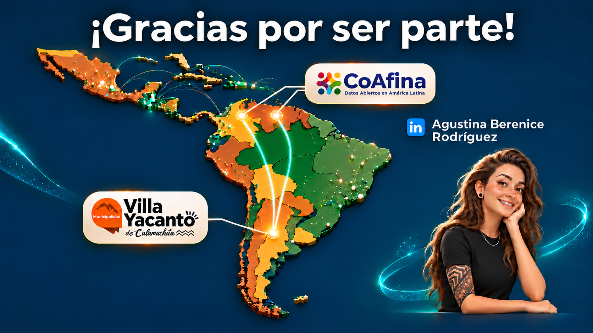

# AmbientIA · CoAfina 2026

### Tu comunidad podría tener un match ambiental a miles de kilómetros

**¿Podés construir el algoritmo que lo encuentre?**



AmbientIA propone descubrir afinidades ambientales entre comunidades de **América Latina y el Caribe** a partir de datos abiertos. Una comunidad argentina y otra ecuatoriana pueden compartir características de sus cuencas, transformaciones del paisaje o presiones ambientales. El reto es encontrar esas conexiones y explicar también sus diferencias y los datos que faltan.

¡Hola! **Soy Agus Rodríguez**, Técnica Superior en Biotecnología, con formación orientada a la biorremediación, y actualmente soy **Directora de Ambiente de la Municipalidad de Villa Yacanto de Calamuchita, Córdoba, Argentina**. También soy docente en una escuela técnica, donde acompaño a jóvenes a vincular lo que aprenden con problemas reales de nuestra sociedad.

En mi trabajo cotidiano me dedico especialmente a la gestión de residuos y me apoyo en el mapeo y la georreferenciación para comprender mejor nuestro territorio. Trabajar en un pueblo con un ejido extenso y una logística compleja me lleva a preguntarme cuántas comunidades de Latinoamérica y el Caribe estarán buscando respuestas a desafíos parecidos, sin saber unas de otras.

**De esa inquietud nace AmbientIA.** Propongo este reto en CoAfina 2026 porque me entusiasma acercar la tecnología y los datos abiertos a las realidades de nuestros pueblos. Quiero que quienes participan puedan poner sus conocimientos al servicio de esas comunidades y descubrir conexiones que abran oportunidades para aprender e intercambiar experiencias. Desde mi lugar, busco unir ambiente y educación para que más personas se animen a ser parte del cambio en los territorios que habitan.

Este repositorio reúne la propuesta, fuentes, licencias y material de apoyo para los equipos. **No contiene una solución terminada ni un dataset ambiental integral ya procesado.**

## Empezá por acá

1. Leé [qué construir y qué debe mostrar la demo](RETO.md).
2. Explorá el [catálogo de fuentes](fuentes.csv) o su [versión JSON](fuentes.json).
3. Probá la carga con [los datos de muestra](datos/) y revisá [sus créditos](ATRIBUCIONES_DE_LAS_COPIAS.md).
4. Consultá la [guía de datos y respaldo](LEEME.md) si necesitás otro acceso o falla un servicio.

Podés descargar el repositorio completo desde **Code → Download ZIP** o clonarlo:

```bash
git clone https://github.com/agusbrod-cell/AmbientIA-CoAfina.git
cd AmbientIA-CoAfina
python verificar_copias.py
```

La comprobación usa Python 3 y su biblioteca estándar. Verifica la integridad de las copias incluidas; no certifica actualidad, exactitud o disponibilidad futura de los proveedores.

## El desafío

Desarrollar una solución digital que permita **seleccionar una comunidad, encontrar comunidades ambientalmente afines en otros países y comprender cada recomendación**. Puede ser una plataforma web, un dashboard geográfico, una API con una experiencia de consulta o una combinación de herramientas.

Los perfiles pueden integrar hidrografía, relieve, clima, coberturas del suelo y cambios territoriales, junto con evolución poblacional, expansión construida, pérdida de cobertura arbórea y sitios documentados de disposición de residuos, según disponibilidad.

Cada match deberá mostrar **qué lo sostiene, qué diferencias existen y qué información falta**. La IA es opcional: un método sencillo, reproducible y bien explicado es un punto de partida válido. Compará el enfoque elegido con una referencia sencilla.

## Recursos incluidos

- **Siete fuentes principales:** GeoNames, BasinATLAS, GHS POP, GHS BUILT S, ESA WorldCover, Global Forest Change y Climate TRACE.
- **Cinco recursos adicionales opcionales:** geoBoundaries gbOpen, Natural Earth, OpenStreetMap, Dynamic World y JRC Global Surface Water.
- **32.871 localidades** seleccionadas de LATAM y el Caribe en CSV, derivadas de GeoNames.
- **15 ejemplos de sitios de residuos**, tres por país, de Argentina, Ecuador, Colombia, República Dominicana y Cuba, consultados en Climate TRACE para 2024.
- Polígonos provinciales de Argentina y Ecuador como ejemplos, y un mapa continental Natural Earth para usar sin teselas web.
- Registro de procedencia, fechas y huellas de los archivos, ejemplos de consultas y una plantilla para documentar derivados.

Las muestras sirven para probar integración e interfaz. Los equipos deberán seleccionar sus áreas y calcular los indicadores pertinentes. No se exige incorporar todas las fuentes ni cubrir todo el continente durante el hackathon.

## Archivos para descargar

- [Presentación final de AmbientIA en PowerPoint](AmbientIA_CoAfina_Final.pptx)
- [Guía de datos y respaldo en Word](AmbientIA_Kit_de_Datos_y_Respaldo.docx)
- [Imagen de cierre con los tres países](imagenes/cierre_avatar_limpio_v2.png)

## Herramientas posibles

Python, Pandas, GeoPandas, QGIS, Rasterio, PostGIS y scikit-learn pueden ayudar en la preparación y comparación. Para mapas e interfaz pueden usar Leaflet, MapLibre, Streamlit u otras herramientas. Cada equipo elige su arquitectura y documenta sus dependencias. No se requiere GPU ni entrenar grandes modelos.

**Earth Engine es opcional y requiere acceso habilitado.** Una licencia abierta de datos no garantiza acceso ilimitado a la plataforma que los distribuye. Si no tienen una cuenta preparada, empiecen por archivos descargables.

## Licencias y uso responsable de los datos

**Este repositorio no asigna una licencia única a todos los datos.** Cada fuente conserva sus condiciones, créditos y excepciones. Consultá [las atribuciones de las copias](ATRIBUCIONES_DE_LAS_COPIAS.md), [las condiciones del kit](CONDICIONES_DEL_KIT.txt), [los respaldos disponibles](licencias/) y los enlaces del catálogo.

- Conservá fuente, versión, fecha de acceso, licencia y transformaciones.
- Los datos OSM usan ODbL, con obligaciones distintas de CC BY.
- geoBoundaries conserva licencias de origen por archivo; no generalices condiciones entre colecciones.
- Climate TRACE no es un inventario oficial ni exhaustivo de basurales.
- WorldCover no mide biodiversidad directamente; pérdida arbórea no equivale automáticamente a deforestación permanente.
- La ausencia de un registro no debe interpretarse como ausencia del problema.

Las imágenes de presentación y los logos no se ofrecen como recursos con licencia abierta. Su inclusión identifica el reto y sus instituciones; no autoriza otros usos de marcas o imagen personal.

**Última revisión de fuentes y preparación de copias: 22 de noviembre de 2026.** Los servicios externos pueden cambiar; [la guía](LEEME.md) distingue descargas, visores y alternativas con cuenta.

## Colaboración

**Mi usuario de Discord es `agusb_rod`.** Me encontrás en el canal del reto AmbientIA y en los espacios de cada equipo habilitados por CoAfina.

Para dudas sobre el reto y acompañamiento durante el evento, usá el canal habilitado por CoAfina en Discord. Para señalar un enlace caído o proponer un recurso, abrí un Issue con la URL, fecha del problema y alternativa, si la conocés. Leé [cómo contribuir](CONTRIBUTING.md).

**Detrás de cada dato hay una comunidad. Que cada conexión permita comprender mejor el territorio y abrir nuevas conversaciones entre quienes lo habitan.**
